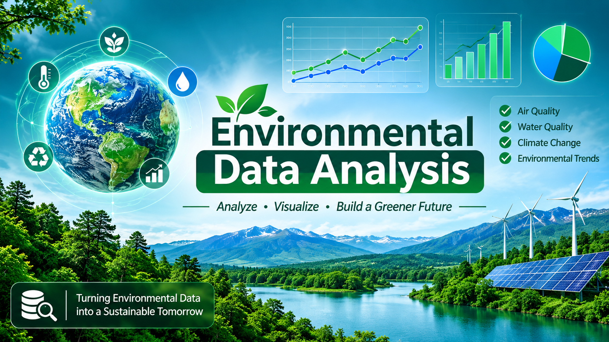

<p align="center">
  
</p>

# 🌍 Environmental Data Analysis

## 📌 Overview

This Java project analyzes temperature and rainfall data in Bangladesh and predicts flood risk levels.

## ✨ Features

- Add monthly weather data
- Calculate average temperature
- Calculate average rainfall
- Generate weather reports
- Predict flood risk (Low, Medium, High)

## 🛠️ Technologies Used

- Java
- Object-Oriented Programming (OOP)
- ArrayList
- Scanner
- Loops and Conditions

## 📂 Project Structure

```
Environmental-Data-Analysis/

├── src/
│   ├── Main.java
│   ├── WeatherData.java
│   └── DataAnalyzer.java
│
└── README.md
```

## 📊 Example Output

```
===== Weather Report =====

Month: June | Temperature: 32°C | Rainfall: 350 mm
Flood Risk: HIGH

Month: January | Temperature: 20°C | Rainfall: 40 mm
Flood Risk: LOW
```

## 🚀 Future Improvements

- Save data to files
- Add charts and graphs
- Add real-time weather API
- Add GUI

## 👨‍💻 Author

MD YASIN
